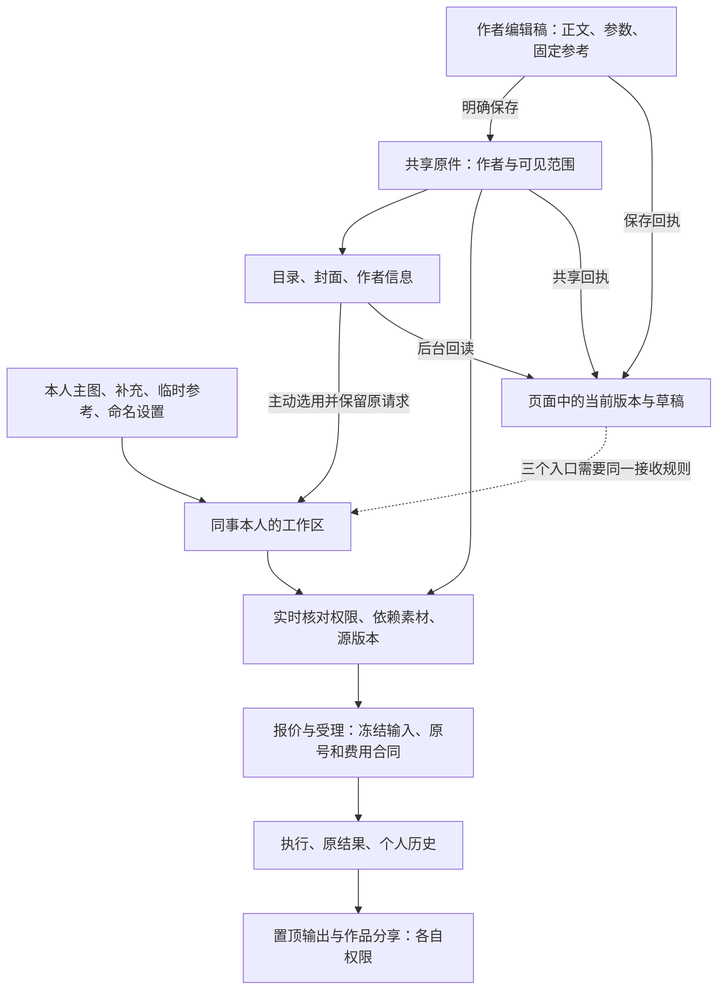

# 模板共享全链路审计与整改顺序

2026-11-08。基线为实际生产 v0.135.11，application source `a50be1b6a131dd93351f68e66cd4981c87f4089d`，BUILD `ZZDh6VfwPFr1Wqr44VKk6`。本轮完成源码链路、生产只读关系统计和新增隔离复现；不修改业务源码、生产共享或费用，不重跑上轮17项和完整构建。后继版本须核相关差量再沿用本结论。

**判断：当前最应整理的是共享状态的写入/回读契约、未知保存恢复，以及存储值与展示值的边界。保留现有单体和数据库，先修有证据的共同原因；现在没有拆微服务或迁移数据库的必要性证据。** 上轮135.11修复了私有原文保存这一条回调，不能据此认为所有写入口和后台读已经统一。

## 1. 先摊开对象和整条链



| 对象 | 权威来源与边界 | 必须保留的语义 |
| --- | --- | --- |
| 作者编辑稿 | 当前页面/既有加密草稿 | 未保存内容不冒充已发布；不覆盖当前输入 |
| 共享原件 | ImageStudioPreset及关联定义 | 作者原件、私人参数副本与工具结果不同；只有原作者管理默认/共享 |
| 本人工作区 | ImageStudioModule + shared binding | publisher是作者编辑入口，live是同事使用入口；本人主图与补充不公开 |
| 共享意图与实际共享 | 未发布preference、首次发布、已发布set-sharing是不同命令 | 选择意图不等于已共享；开关最终事实来自确认回执/服务器投影 |
| 素材与提示词 | 固定参考、风格、skills、原图及私有正文 | 模板可见不自动授予原件下载/正文权限；依赖失效要明确 |
| 目录/封面 | 目录投影、固定封面及其独立配方版本 | 展示摘要不能冒充完整定义；修改封面不能误改主图或历史 |
| 新生成 | tasks、报价与单张/批量的共同输入解析 | 提交时鲜核身份、源版本、素材与费用；不允许旧报价借新版本 |
| 已受理和历史 | 冻结快照、原任务号、账本、原件 | 不按当前模板重写旧合同、不自动重发；历史可见与新生成资格分开 |
| 置顶/广场/链接 | result-pins、作品和媒体各自授权 | 结果分享不带出私人输入/正文/原件权限；也不能把已有独立分享当模板开关 |

不同的“版本”也必须分清：workspace revision保护本人工作区；sourceRevision是源行修订；definitionToken是定义及依赖摘要；catalog marker只表示目录失效；cover revision保护封面配方；上下文短码用于识别正文；报价/费用修订属于受理合同。不能把任意两个都叫revision后互相代用，也不能按不透明token的字典顺序判断新旧。

## 2. 新确认的问题

以下是当前源码的可复现行为；“诊断通过”指成功复现问题，不代表功能健康。除另注外尚未修复上线。

| 编号/优先级 | 证据与实际影响 | 状态及最小处理 |
| --- | --- | --- |
| A01 / P1 | 实际React18 hook已有旧请求在途，把activeModule改成确认版本8后，旧请求仍被投递给receiveSharedDefinition，最终页面状态变回7、source token也退回旧值。入口仅比id/preset，没比较新旧，也没随普通保存推进读取代次。 | 已隔离复现。所有确认写入和读投影经同一接收规则；确认写推进读取代次，旧读不得覆盖新状态。不是再补一个Math.max就结束。 |
| A02 / P1 | 真实共享事务把作者工作区1升为2，回执含moduleRevision；当前onSettled只更新isShared，不接新revision。原回调隔离示例回执9、页面仍8，依赖异步刷新才能追上。 | 已隔离复现。开关、原文、保存默认、命名/删除等所有受影响写入口统一消费完整确认状态；共享后立即保存不能再靠轮询补版本。 |
| A03 / P2 | 普通moduleSaveRequest只在useRef；temporaryDraftPayload没有原保存编号。实际React卸载/重挂后ref变null；固定参考修复、开关、原文等另有耐久机制，普通定义保存没接齐。 | 已证恢复缺口。持久保留最小命令身份和待确认状态，刷新先查询原回执；不把私有正文/完整signature直接塞本机存储。服务器回执未丢，不据此声称已发生重复生成或重复扣费。 |
| A04 / P2 | 严格加密合成库中，作者的只读definition接口返回存储密文，专用private-editor接口返回同一正文的授权明文；TemplateDefinitionRead直接渲染definition.context。 | 已新增隔离复现。只读原文必须经过现有正文授权与解密/脱敏边界；管理员身份不能绕过私有策略。不能简单全局解密或改补充输入的明文约定。 |
| A05 / P2结构耦合 | 仅通过真实rename API改名称，提示词、上下文、参数、参考和风格均未变，definitionToken仍改变。任务入口严格比较token，旧报价因此会要求重读/确认；封面保存也推进源时间并参与摘要。 | 已证行为，未声称本次线上卡顿由此引起。区分编辑CAS和生成输入指纹，撤权/依赖访问仍须鲜核，避免把展示变更混入生成输入。 |
| A06 / P2故障隔离 | 合成库在无关模板复现记录注入坏JSON：共享目录和旧revision路径整体抛SyntaxError，健康模板的定向读取仍成功；撤除合成故障后目录恢复。 | 已复现风险，生产本次坏JSON=0。目录摘要应避免全量正文解密，按条目表达可定位的失败；真实身份/私有素材保护不能因“容错”跳过。 |

### A01为什么不被上轮补丁完全覆盖

135.11的onPrivateDefinitionSaved会触发refresh并隔离自己的metadata读取，修复了该入口。但普通共享默认保存的成功分支仅在首次publishNew时调用onSharedRefresh，其他成功结果与旧后台读取仍可能交错；receiveSharedDefinition又直接整项替换。局部回调正确，不代表整个接收端已经有统一的新旧规则。实际hook复现使用延迟的旧GET、更新后的同模块props和真实React effects，不是只手工调用一个setter。

接收规则必须处理同workspace不同源版本、依赖变化但源时间未变、撤权及账号/目标切换。安全做法是确认写入推进当前读取代次、受影响状态按权威来源更新，保留本人未保存字段；不能仅比较workspace数字，也不能比较hash大小，或为了保新状态吞掉真实撤权。

## 3. 生产只读盘点及历史兼容层

18:02Z元数据统计：46个原件，其中38个标记共享；117个工作区，其中106个带source_preset_id；82条shared binding、32条publisher映射、17条reproduction记录、277条共享命令回执、2个目录marker。上述绑定/作者映射/复现记录JSON格式异常均0，工作区引用不存在源原件的计数0。没有读取提示词正文，也没有写生产。

18:08Z追加关系核对：82条绑定对应32个publisher、50个live，绑定找不到工作区0，已匹配工作区的owner/source不一致0。另有24个带来源但没有新式binding的工作区：共享源下16个（作者本人13、同事3），非共享源下8个（作者本人3、同事5）。14个原件没有新式publisher映射，其中11个标记共享、3个非共享。

这证明旧兼容路径仍在真实使用，**不证明这些旧记录是坏数据**。不能把106−82直接当迁移缺陷，不能按名称猜新原件或自动回填绑定。后续必须把现代publisher/live、旧apply复制、历史参数副本和已撤回来源列成测试矩阵；需要逐模板辨认的11个旧共享原件尚未做实页/生成验收。

v2主入口已经使用轻量目录marker；不能把旧全量路径的失败说成当前每次轮询都必然发生。兼容路径和完整目录仍调用全量依赖摘要；sharedDependencyState对复现记录先JSON.parse/解密，再进入分页及单项resolver，故存在A06故障放大。既有全局私密绑定兼容校验仍保持，不能为了目录可用直接忽略无权或损坏的私密记录。

## 4. 已核对的保护，以及证据边界

- 新增真实后端合成检查：普通同事可选用共享源，正文在普通DTO中不公开，不能保存作者定义；关闭共享后新使用被拒绝，本人工作区仍在；重新共享可恢复使用。没有创建生成任务或账本记录。
- 源身份、owner、scope、company/Feishu边界在服务端再核；publisher/live绑定与source相匹配。管理员不是他人模板作者，生成资格与查看正文权限分开。
- 单张/批量报价、创建、恢复沿resolveOwnedStudioTaskSharedUse等核对源intent；worker使用已受理冻结合同。此部分复用135.11完整native/pricing及既有合同证据与源码，不另行收费生成，也不冒充新实页/真实批量验收。
- 普通结果只读本人任务；置顶按模板源scope和独立pin文档处理。已有135.4置顶/目录恢复证据不重跑；旧可信谱系、全局私密兼容坏行探测与同机资源线索仍沿原记录保留。
- 新命名设置沿owner/module命名空间，不新建模板/工作区、不发布作者定义。复用已完成12项证据，原主图与私有正文不随参数方案复制。
- 飞书发图导航沿已受理任务的owner/module/batch生成，角色工作台有独立工具路径，不借当前浏览器选中模板归属；链接仍受站内权限约束，转发不等于授予模板/私人结果访问。此处只读源码，不进行飞书外发或真实点击验收。
- 现有成功生命周期审计已保留业务请求编号和前后版本，模块/shared路由也有HTTP trace；不是“没有日志”。但presets路由未接同一HTTP trace包装，拒绝阶段没有贯穿所有入口的业务command/scope/version关联，容易只剩泛化409。应补现有记录的关联字段，不新建监控平台、不记正文或凭据。
- 固定封面、作者只读、权限投影已有部分工程检查接入构建；本次17项版本衔接检查和旧sharing专用脚本未出现在check-image-recovery的直接入口中。不能把“有脚本”“完整构建通过”当所有交集已被覆盖。诊断脚本当前用于复现坏行为，修复时必须改成目标行为的红绿回归，不能原样当健康准入。

当前没有证据支持“所有共享正常”，也没有据这些问题证明发生越权泄漏、重复扣费或丢失原图。真实客户端、全量旧模板、收费生成和多人压测仍缺证。

## 5. 整改顺序和防复发验收

| 工作包 | 做什么、为何优先 | 完成条件和保留边界 |
| --- | --- | --- |
| R1：统一确认状态与读取接收 | 一并处理A01/A02：同一账号/工作区的确认写入、目录同步、hydration和共享回执用共同的状态接收规则；所有成功回执消费其有权声明的版本和状态。 | 真React延迟旧读不能把8变7；回执9立即进入页面；同workspace源版本变化、撤权/重共享、切号/切模块和本人新输入均有明确预期。保旧回执相容，不移除CAS。 |
| R2：接齐保存恢复与正文读取 | A03持久最小命令身份，刷新仅读原号；A04复用正文现有授权/解密接口并输出明确的可读/受保护投影。 | 断网→刷新能查回原保存，不换号、无本机明文私有内容；作者只读与编辑读取一致，普通同事/不满足私有策略的管理员不因修复扩大权限。 |
| R3：分清展示与生成输入 | A05保源编辑CAS，单独表达生成所需内容摘要；报价/创建共同使用，权限和依赖撤回单独鲜核。 | 改名/裁封面不使未改变输入的报价失效；改正文/有效参考/风格会使旧报价失效；撤权仍拒绝新用，已受理与原费用合同不重写。需沿现协议相容演进，先对照再切消费者。 |
| R4：缩小故障与读取范围 | A06目录摘要不先处理全体正文；明确受影响条目/依赖，严格区分“记录损坏”和身份/媒体权限未知；按页定向加载。 | 合成坏模板只影响其可判定条目，健康定向读取可用；不吞存储/私密保护错误。先核旧私密索引边界，再谈缓存或新索引。 |
| R5：旧路径与运行闭环 | 分类上述24个工作区/11个共享原件，补最小兼容样本；将R1/R2红绿检查接入已有工程入口，补安全元数据关联。 | 不批量迁移/回填/覆盖历史；现有正常路径继续可用，未知命令保持；后继版本改共享上下游时能由可复跑检查发现接线遗漏。 |

R1、R2先做；R3是合同差量，不能为了消除一次409草率改掉生成版本保护。R4、R5沿实际规模与故障边界推进，不以“将来人多”为由引入新服务。可见页签当前每2秒检查，老目录路径有全量依赖工作，legacy read-snapshot按进程排队（上限32、排队5秒门限）；这是明确增长成本，但本轮没有吞吐/SLO压测，不承诺承载人数或百分比提升。

防复发的具体规则：

1. **修改矩阵而非只改按钮。** 原文保存、保存默认、首发、开关、改名、封面、个人设置、删除/恢复分别列明会改变哪些版本、哪些读取方必须接回执。
2. **调用方和消费者一起验。** 后端返回字段还必须验证页面真正采用；状态观察要覆盖延迟旧读和重新挂载，不能只测单个函数。
3. **持久状态先于请求。** 可能结果未知的命令先保最小原号，明确回执才解锁；界面状态/超时/空查询不是未执行证明。
4. **存储/运行/公开投影分开。** 密文只留存储合同；运行明文经授权，普通公共DTO不带正文；本人补充仍沿已有明文约定。
5. **复用安全记录和现有检查入口。** 记录安全的actor/object/command、预期/实际版本、阶段、scope和outcome；不给日志加提示词/密钥。复用有效证据，只对实际变化的交集补检查。

## 6. 独立复跑与交付状态

诊断脚本：`scripts/template-sharing-chain-audit.cjs`。在候选物理私有依赖、无生产.env/storage链接的源码目录运行：

```sh
REQ01_RUNTIME_ROOT=/path/to/existing-compatible-react-test-runtime node /path/to/template-sharing-chain-audit.cjs
REQ01_RUNTIME_ROOT=/path/to/existing-compatible-react-test-runtime node /path/to/template-sharing-chain-audit.cjs --backend
```

React与renderer版本必须等于项目React（本次18.3.1）。backend模式复用既有17项脚本的已核 isolation/loader scaffolding，单独创建临时SQLite/合成私有策略和密钥，屏蔽网络，结束销毁；不会重跑原17项。运行先决条件是有本项目Node/Prisma依赖及对应schema engine，不连接生产库。`--backend --definition-only`仅补查只读正文链。此为工程诊断，不是用户功能验收。

原始证据在服务器 `/data/video-api-debugger-engineering/template-sharing-chain-audit-20261108/`：audit01为新增后端/故障隔离及原回调复现（18:02:47Z）；audit02补真实React交错/重挂载（18:04:59Z）；audit03只补正文读取并核最终诊断脚本（18:11:33Z）。三次均退出0表示预期问题复现成功；未将它们冒成“业务通过”。app源码SHA逐项绑定135.11归档；audit01/02的不同脚本SHA和原时间保持，不覆盖原证。

生产库存仅聚合统计和关系计数，18:02/18:08Z原时间保留。正式根私有归档 `docs/materials/2026-11-07-pin-wide-gallery/recovery-20261108/sharing-chain-audit/`，不含生产正文/凭据/数据库。源码索引本轮未返回有效结果，沿实际API/调用方定向读取，不冒称图索引检查成功。

**本轮是全链路审计与整改工单交付，新增缺陷尚未修改上线。** 线上仍沿既有135.11发布事实；本轮只提交诊断脚本、审计和待办，不升版本、不重启网站、不占后继发布窗。真实浏览器和用户手验安排保持。
