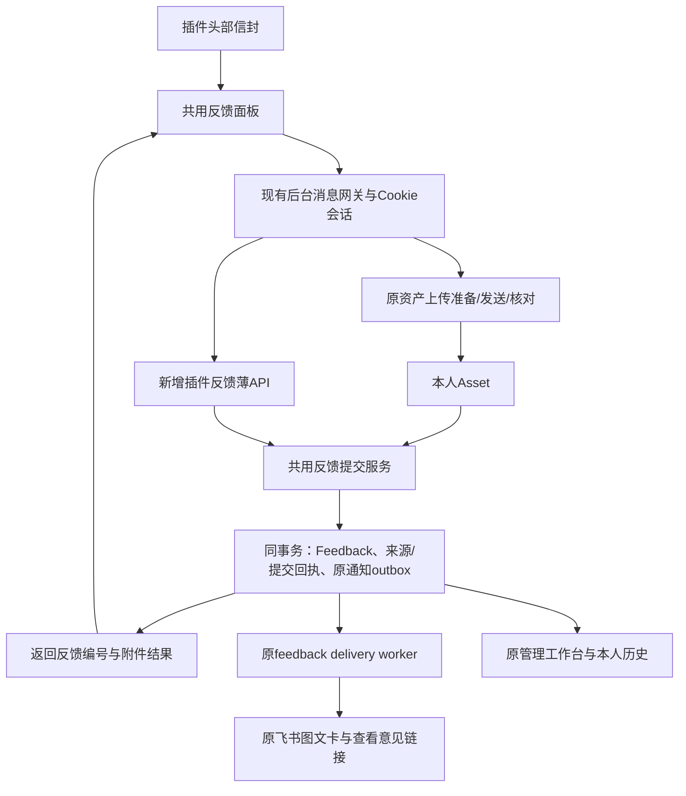

# BR-FEEDBACK01 插件右上角信封反馈入口与后端复用

- 日期：2026-11-02（America/Los_Angeles）
- 工单版本：v1.1.0 / R02
- 状态：已实施、工程检查通过并发布。后端v0.128.0已保护部署，插件v0.4.0签名包已发布并回读核同；A01–A10待用户手动验收，未实发反馈/飞书测试。
- 用户要求：把网站后端发送反馈的链路和设计复用到 SD2 生产桥插件，在顶部右侧放小信封入口。
- 正式项目：`/Volumes/Data/Projects/video-api-debugger`；关联插件：`/Volumes/Data/Projects/sd2-production-bridge`。
- 取证源码：后端干净副本 `/Volumes/Data/Projects/video-api-debugger-worktrees/cover-directory-one-second-20261101`，`6629e540dadaa816d17e6784a904d24ec50262a1`；插件干净整合副本 `/Volumes/Data/Projects/.worktrees/sd2b-integration`，`36091a44b59f9eccda2ebfbcc1e854ba0ac94806`、源码 manifest v0.3.6。
- 版本边界：插件正式目录当前检出的是 `cc/remote-config` / v0.2.12，不能直接把新功能落回该旧线而覆盖整合成果。以上提交仅是取证位置，实施前核对当时真实发布线、未提交改动和并行占用；不把历史提交固定为未来起点。未核验用户当前安装版本。

## 1. 目标与范围

让用户在 ChatGPT、Midjourney、即梦的插件浮层顶部右侧点击信封，即可描述问题并附上可选图片；反馈进入网站原反馈工作台、本人历史和现有飞书通知链。

完成标准：入口可见；一次提交形成一条本人反馈；返回反馈编号后显示“已提交”；截图按原权限核验；网络丢回执可以核对原提交；飞书异步发送，不让用户等待管理员实收。

本单包括共用插件表单、两个头部适配、后台网关、后端领域服务复用、插件来源识别与提交回执。网站React表单与插件原生DOM运行环境不同：复用后端领域能力/接口合同，三个插件站点共用一个UI组件，保留现有框架。沿用现有 Feedback、Asset、Notification、PlatformSetting；**不新增表、不做历史回填或迁移**。

不包含重做反馈管理系统、私信/即时聊天、自动截图、自动上传聊天/提示词、自动技术错误上报改造、扩展新权限或商店上架。本单不恢复已暂停的性能工程，也不替其他工单勾选完成。

## 2. 已核对的现有链路

| 环节 | 实际实现与证据 | 本次处理 |
| --- | --- | --- |
| 网站入口 | `src/components/AppShell.tsx` 挂载 `src/components/FeedbackWidget.tsx`；现为右下浮动“提意见”，含正文、图片、按用户区分的草稿 | 网站入口保持；插件采用同样的内容结构和反馈含义 |
| 网站上传 | Widget 调 `src/lib/http/file-upload.ts` 的 `uploadFileAsAsset`，沿原资产上传协议保存本人 Asset | 复用服务器上传协议、归属与指纹核验；插件增加必要的 SW 传输适配 |
| 反馈创建 | `src/app/api/feedback/route.ts` 的 POST：非空正文、可选 session、附件快照，在同一事务创建 Feedback 并入通知队列 | 抽取同一领域提交函数，网站与新插件入口共用；网站旧请求行为兼容 |
| 附件安全 | `src/lib/feedback/attachments.ts` 的 `snapshotFeedbackAttachments`：本人 active Asset、URL/ID/hash/MIME/体积一致，去重；原件在发送前复核 | 原函数直接复用；不接受任意远程图片地址代替 Asset |
| 通知入队 | `src/lib/feedback/notification.ts` 的 `enqueueFeedbackNotification`，与反馈保存同事务；按配置选择既有管理员收件人并核身份 | 不在插件放飞书凭据或另选收件人；通知关闭时仍可保存反馈 |
| 实际投递 | `scripts/process-feedback-deliveries.ts` → `src/lib/feedback/delivery.ts`；复用 outbox、CAS 租约、退避、receiptId、unknown 及最多12次/50分钟的现有窗口 | 沿原 worker；新入口不直接调用飞书发送 |
| 飞书展示 | 现有图文卡、截图、管理员“查看意见”链接与处理回执 | 只补清楚的插件来源标签，不改变原投递协议/收件人/操作保护 |
| 用户与管理 | `/feedback`、`/feedback/[id]`；`/admin/feedback` 及原管理 API，保本人和管理员权限 | 继续使用原入口、处理/回测流程 |
| 插件身份 | `background/auth.js` 通过 SW `getMe()` 读网站 Cookie 会话并广播；网关 `background/sd2-api.js` 已用 `credentials: 'include'` | 复用；本功能无需新增令牌或借用设备绑定身份 |
| 插件外壳 | v0.3.6：MJ/即梦共用 `content/common/panel-shell.js`；ChatGPT 仍有自己的 `content/chatgpt/panel.js` 头部；共同使用 `shared/panel-theme.js` | 一个共用反馈模块、两个轻量挂载点，不分别实现三个反馈表单 |

重要区别：`/api/bridge/client-reports` 与插件 `BRIDGE_REPORT` 是自动技术遥测，服务端对自由正文做摘要，且有每日指纹去重/暂停策略；**不能承接这次用户意见与截图**。本单不改该链。

旧 `/api/feedback/upload` 已明确废弃，不能接入。当前插件 `assetsUpload` 是简化 multipart 调用；服务器仍有旧兼容分支，但它缺少本次需要的完整 owner/requestId/原上传核对记录，不能直接据其网络错误重传。

## 3. 用户界面与交互

### 3.1 信封位置

- ChatGPT 头部及 MJ/即梦共用头部：在账号区域右侧、`⋯`/显示模式切换区域之前，放一个同现有 `.ib` 尺寸的按钮，线性信封 SVG 约16px，复用主题和焦点样式。`aria-label`、title 为“反馈”。
- 完整、极简模式常显；胶囊模式保原展开含义，展开后可见同一入口。信封不藏进更多菜单，不新增默认红点、长文标签或独立悬浮球。
- 点击按钮不触发面板拖动、折叠、队列启动或网页发送；两处头部只挂载同一公共组件。

```text
现有标题/状态 …… [网站登录] [SD2账号] [信封] [⋯] [显示模式]
                                        └─ 反馈
                                           哪里不好用，或想怎样改？
                                           [正文输入区]
                                           [添加图片 / 可粘贴截图]
                                           来源摘要 · 附带信息
                                           [关闭]       [提交反馈]
```

### 3.2 反馈面板

- 点击打开锚定信封的紧凑编辑层，默认向下、右侧对齐，边缘避让；宽度约360px并受可用视口限制，内部滚动，提交/关闭可达。复用现有 Shadow DOM、主题及事件隔离，不引入另一套 UI 框架。
- 一个正文输入框必填，图片可选；不再要求标题、分类、用户姓名或手填设备信息。Enter正常换行，输入法确认不提交；提交只由明确提交动作触发。
- 来源自动显示“SD2生产桥 · ChatGPT/MJ/即梦 · 插件版本”。附带信息按需展开，可查看并移除当前页面位置；URL不带 query/hash，不采集聊天正文、提示词、第三方账号/Cookie、令牌或文件路径。
- 选择文件/拖入/粘贴截图为用户主动动作。沿网站前端限制 jpg/png/webp、单图5MB；服务器原核验仍最终生效。不为此申请截屏或额外站点权限。
- 已上传图片可移除当前反馈引用；不删除 Asset 原件，避免影响其它引用。失败图片保留状态，用户可重试/移除后提交。
- 关闭键、点外部、Esc走同一关闭路径并保留真实草稿；只关最上层，不点击穿透。编辑区内拖动、图片拖放、选择文件不误关。关闭后焦点回信封。
- 反馈打开时，Esc先作用于反馈；按键/粘贴不触发网页聊天、插件队列提交或胶囊切换。CG和共用壳的全局快捷键入口需识别当前反馈层；关闭后恢复原快捷键。
- 面板移动/缩放时跟随锚点；若外壳收起导致锚点消失，保存草稿并关闭反馈，重新展开后可恢复。小窗口采用可用视口内的紧凑面板，不裁掉关闭、错误或提交。

### 3.3 状态与恢复

| 状态 | 用户看到/能做什么 | 系统行为 |
| --- | --- | --- |
| 未登录/登录失效 | 原位置提示“登录 SD2 后提交”，使用既有登录入口，保已存在的本人草稿 | 不降级成匿名反馈；账号从服务端 Cookie 会话取得 |
| 编辑 | 正文、图片与一个提交键 | 按 SD2用户+站点+标签/反馈实例保存草稿；后台校验身份后才发送 |
| 图片上传中/失败 | 对应图片局部进度/错误，可移除或沿原请求核对 | 不清空正文，不因图片失败创建另一条反馈 |
| 提交中 | “正在提交”，防重复操作；可以安全收起 | 在真正发请求前持久保存 operationId 与冻结输入，关闭不表示取消服务器请求 |
| 已保存反馈 | “已提交”，有“查看反馈”链接，回到原工作位置 | 以网站事务提交及反馈编号为准；不显示“飞书已送达”来冒后台保存 |
| 部分附件未核验 | “反馈已提交，X张图片未保存”，原反馈链接可用 | 复用返回的 saved/notSaved 计数，不能无提示丢图或再次自动创建反馈 |
| 结果未知 | 保留原稿与操作，提供“核对提交”；需要重试时仍是原编号、原输入 | 先查原回执；GET未找到不是原POST必然未受理。无自动换号/重发 |
| 切换账号 | 保存原账号草稿，切换到新账号独立草稿 | 不把原账号正文、附件、回执套给新账号；迟到结果只结算回原归属 |

自动技术遥测的“401/404暂停6小时”不能套到手动反馈。新接口404时显示暂不可用并保稿，兼容接口恢复后再核对；不偷偷改走匿名接口。

## 4. 复用架构与接口设计



### 4.1 身份和传输

- 页面反馈组件只发明确的 `FEEDBACK_UPLOAD`、`FEEDBACK_SUBMIT`、`FEEDBACK_QUERY` 等扩展消息；所有 SD2 网络请求仍由 SW 的 `background/sd2-api.js` 发起。
- 新反馈消息仅允许本扩展的现有站点 content script/扩展自有页面；按实际 sender 取得站点，固定 SD2 目标 origin。正文和图片输入均作为不可信输入校验，不开放任意 URL 代理或任意后台命令。
- 新反馈 API 使用当前有效网站 Cookie session，匿名401；服务端重新校验 `expectedUserId` 与当前用户一致，切号冲突409。该字段只是匹配校验，不能当身份凭据。附件上传沿现有 `X-Upload-Owner-Id` 保护。
- 本功能不把 session Cookie、panel token 或飞书凭据放进 content script 消息/草稿，不扩大 Bearer、设备绑定或 iframe 权限。`/bridge/panel` 原令牌机制不需要为此改造。

### 4.2 后端共享提交服务

在 `src/lib/feedback/submission.ts`（新增）集中抽取正文规范化、附件快照、Feedback创建与 `enqueueFeedbackNotification`。站内 POST 调同一函数，保原匿名正文、附件筛选、响应、辅助上传日志及通知关闭时仍保存的行为。

新增薄入口 `src/app/api/bridge/feedback/route.ts`：

| 方法 | 契约 |
| --- | --- |
| POST | `{operationId, expectedUserId, content, imageUrls, uploadedAssetIds, context:{site,extensionVersion,pageUrl?}}`；首次201、同号同输入200回放，均返回 `{success:true,replayed,feedback:{id},attachments:{saved,notSaved}}`。context由服务端白名单规范化，站点仅chatgpt/midjourney/jimeng；pageUrl可缺省，携带时只能对应站点且去query/hash。 |
| GET `?operationId=…&expectedUserId=…` | 同账号精准核对原回执；返回 accepted及原feedback.id/附件计数，或not_found。未登录401、原身份不匹配409；不返回他人内容，也不借管理员身份读其它用户草稿。 |
| 冲突/异常 | 同号不同输入409；校验失败400；内部错误返回可判别原因并保客户端原操作。无法确认事务结果时按未知处理，不能宣称“肯定没有保存”。 |

**提交回执不是飞书receiptId。** 沿现有反馈修复操作的 PlatformSetting 持久回执惯例：

- 唯一键 `feedback-submit:v1:<userId>:<operationId>`，保存规范化输入摘要、反馈编号、已保存附件计数和必要版本；同事务写 Feedback、该回执、来源元数据及原 outbox。
- operationId在用户点击一次提交时生成，冻结对应输入；原号先精准查既有回执，再核新附件/执行新创建。同号同输入直接返回保存结果；不同输入冲突。并发依赖数据库唯一键和原事务，不能只靠SW内存去重。
- `feedback-source:v1:<feedbackId>` 保存小型插件来源元信息（站点/版本/规范化页面位置），避免更改Feedback schema或把资料塞进任务编号、User-Agent或正文。保留原 content；不复制聊天记录。
- 两类键按唯一key读写，沿 `catalog-directory-writes.ts` 已核的失效分类不会触发模板/资产目录版本；禁止无条件扫描PlatformSetting或逐条全表查来源。来源详情按feedbackId精准读取；列表按规范pathname映射来源，必要本页元信息批量按key取。
- 回执与反馈数据一起保留，程序回退不清回执。R02追加授权已把网站旧入口纳入同一提交服务：新版Widget先持久保存原编号/冻结输入，未知查原号，主动重试仍同号。旧无operationId请求维持原兼容合同，旧已打开页面需刷新加载新版Widget；不声称旧客户端自动获得新保护。

### 4.3 图片上传和草稿

- 新反馈截图使用既有 raw-v2 协议的小图片路径：`POST /api/assets/upload-ticket`（`mode:raw`）→ `POST /api/assets/upload` → 原号GET核对及需要时 `/recover`；参考现有 `file-upload.ts` 的 `performRawUpload`/恢复实现，不复制大文件、云直传及分片整套流程。
- 发字节前持久化 ownerId、uploadRequestId、hash、MIME、size和raw-v2阶段/nonce；校验准备回执后才发原文件。服务端继续校验hash/实际字节、归属、资产安全和原受理状态。
- SW网关补必要的协议适配，后台保存的是原文件；本功能不裁切、缩放或转码。网络未知只查原上传，不因超时换号传第二遍；只有服务器原证明允许恢复时才沿原号接续。
- Chrome扩展消息按JSON序列化设计，复用已存在的dataURL/base64→Blob适配传单图，校验解码后的真实体积。草稿只存文字、asset引用和小型操作描述，不在storage.local塞图片base64或整份日志。
- 未完成上传的本地File在页签重载后不能冒称已恢复：保留文字和上传标记，提示重新选择同一文件，核同指纹后查询/恢复原上传。已上传Asset无需重复上传。
- `chrome.storage.local`新增有版本、按SD2用户、站点及标签/反馈实例隔离的反馈键，SW和UI沿原协议读写；发送中冻结快照不随新编辑变化。首次写入失败不得宣称草稿已保存，已提交新编辑也不能被迟到返回清掉。同站多标签不覆盖彼此正在编辑的正文；恢复旧草稿保原页面上下文，不静默改为新页面。

### 4.4 来源和后续处理

- 插件反馈的 `Feedback.pathname` 使用服务端规范值 `/plugin/chatgpt`、`/plugin/midjourney`、`/plugin/jimeng`；`page_url`为用户允许附带的规范化实际页面地址，可为空。
- 在新增纯映射模块 `src/lib/feedback/source.ts` 统一三项来源标签，供 `feedbackPageName` 与后台客户端复用，不把含Prisma/飞书配置的服务端模块导入客户端。飞书卡和后台可识别“插件 · ChatGPT/MJ/即梦”；版本等细节从来源元数据按需展示，不给用户多一组表单。
- 继续用原管理员反馈详情链接、飞书确认/修复回测及本人 `/feedback/[id]`。新来源不变成新的权限身份，不绕过原反馈归属。

## 5. 明确的修改位置与工作包

以下路径分别相对各仓库；新增名称是本单设计，现有文件是已读证据。实施时仅核变化，不重新安排整套调查。

| 包 | 后端 video-api-debugger | 插件 sd2-production-bridge | 可核对结果 |
| --- | --- | --- | --- |
| W1 共用领域与回执 | 新 `src/lib/feedback/submission.ts`；改 `src/app/api/feedback/route.ts` 提取调用；新 `src/app/api/bridge/feedback/route.ts` | 无 | 原网站行为兼容；插件登录、身份匹配、同号回放/冲突、同事务反馈+回执+outbox成立 |
| W2 共用反馈组件与网关 | 原上传协议不另造接口 | 新 `content/common/feedback.js`、`background/feedback.js`；改 `background/index.js`、`background/sd2-api.js`、`shared/protocol.js`、`shared/constants.js`、`shared/storage-keys.js` | 一个表单/草稿/提交状态；明确消息路由、会话及raw-v2原号恢复，无任意代理 |
| W3 两处头部接入 | 无 | `content/chatgpt/panel.js` 与 `content/common/panel-shell.js`；`manifest.json`按依赖顺序加载共用模块 | 三站同一信封/表单；拖动、胶囊/极简/完整、Esc与原队列行为保留 |
| W4 原工作台与投递标识 | 新增纯映射 `src/lib/feedback/source.ts`；改 `src/lib/feedback/notification.ts` 页面名映射及 `src/app/admin/feedback/AdminFeedbackClient.tsx`；原 `src/app/api/admin/feedback/route.ts` / `[id]/route.ts` 按本页/单条精准投影来源 | 仅复用现有“查看反馈”跳转 | 原后台和飞书能定位插件来源，原截图/接收/回测兼容 |
| W5 检查与发布收口 | 原反馈工程夹具、类型/lint/构建及既有部署检查 | 现有`tests`风格新增定向反馈用例，沿原构建/打包约定 | 真实检查与待手验分开记录；后端先于新插件可用 |

- [x] W1：共享提交函数与插件薄API/回执完成，原网站接口结果及权限不变。
- [x] W2：公共编辑层、SW消息、已核上传协议和持久恢复完成。
- [x] W3：ChatGPT、MJ、即梦入口及两处快捷键/拖动适配完成。
- [x] W4：来源映射、原后台和本人历史/投递链兼容完成。
- [x] W5：必要工程检查与发布保护完成；A01–A10留用户手验。

## 6. 架构判断与残留

共享资源是同一反馈表、资产、PlatformSetting、Notification及SQLite写事务。采用共用领域服务与独立认证薄入口，避免两套反馈写入/收件人配置；文件网络上传、读取和飞书调用均不进入新增提交事务。事务仅做必要的归属/快照及持久写入。

原素材上传可能复用已有同字节Asset；移除反馈图片因此只解除引用。回执/来源用精准key查询，避免用户数增长时全表扫描或人为让所有模板目录失效。UI公共组件仅两个头部适配，不为本功能统一重做整个面板。

R02已修网站新版入口的提交级幂等机制；相容guard保原号reader/replay并关闭新建，不能直接回退到忽略operationId的旧POST。残留是旧无编号客户端兼容边界、其它功能的简化上传恢复，以及真实Cookie/粘贴/布局/飞书实收待手验；不扩建队列、设备token、存储平台或权限。

## 7. 够用验证与用户手验

按实际影响为L2：新增本人反馈写入与既有通知链，权限/附件/提交回执是重点；不改变费用或扩大共享权限。当前仅设计与源证核对，未执行下面实施检查。

工程检查使用隔离身份、数据库和替身外部transport，禁止因测试真实发送飞书、创建生产反馈或触发生成费用：

- 共享提交的原网站兼容，正文/附件验证、用户A/B/未登录身份，错误不冒成功。
- 同operation并发/迟到/重试只一条Feedback和一份outbox；同号不同输入409；事务中途失败整组回滚；GET原号正确隔离，not_found不触发自动POST。
- 图片准备/发送结果未知、SW重启、重选同文件，保原owner/requestId/hash；第三方URL、错asset/URL、非法MIME/体积不会被当有效截图保存。
- 草稿/回执跨账号隔离；晚返回不覆盖新编辑；未上传File不冒持久恢复；移除引用不删原Asset。
- 新来源两个PlatformSetting前缀不引入模板/资产版本失效；来源查询精确key/本页批量；原网站匿名契约及原自动client-reports不变。
- 后端按项目现有定向检查、完整类型/lint/候选构建和发布机制；插件按现有测试、JS语法、manifest加载顺序和打包检查。不为工单新建全面验收平台。

| 手验项 | 操作与通过标准 |
| --- | --- |
| A01 | 三站完整/极简头部右上有同款信封；胶囊展开可找到；旧模式、拖动、缩放与队列保留 |
| A02 | 点击锚定打开；窗口边缘/窄窗口/长内容下关闭和提交可达；面板移动后跟随 |
| A03 | 关闭/外部/Esc保草稿并回焦点；内部拖放不误关；Esc不收起原队列、输入法不提交 |
| A04 | 正文+粘贴/选择截图提交后有本人反馈编号，后台和本人历史能找到，来源/实际页面正确 |
| A05 | 飞书接收原图文卡/截图与正确后台链接，按原管理员范围；提交完成不等待飞书送达 |
| A06 | 离线、请求回执丢失、SW重启后核对原操作，重复点击不形成两条反馈或两次通知 |
| A07 | 登录失效/切号不匿名发送、不串文字/附件/回执；回原账号可恢复现场 |
| A08 | 图片上传失败或被排除清楚说明；已上传不重复上传；未保存的本地File需重选如实提示 |
| A09 | 网站原反馈正文/截图/管理员处理/飞书回测正常；自动技术上报不受影响 |
| A10 | 后端回退或接口404时保草稿/原回执，旧插件继续原功能；程序恢复不删除反馈、媒体或回执 |

项目默认用户手验。真实页面、用户反馈写入和飞书实收只在相应授权下执行；构建/隔离工程不冒A01–A10通过。

## 8. Git、实施顺序与恢复

R01工单阶段仅保存文档并推送02bcdaf88，未升级应用/插件或部署。R02已获明确实施授权，沿既有干净副本分别形成后端/插件聚焦提交，保护正式根脏改。

未来实施：核当前后端/插件发布线及脏改 → W1/W2 → W3/W4 → 够用检查 → 后端保护部署 → 插件按现有版本/打包发布规则交付 → 用户手验。两仓库分开提交与版本，不能把当前旧root插件分支覆盖整合分支；不回滚他人变更。

后端失败保原运行版；若必须回程序，保Feedback、Asset、Notification和全部新元数据/回执。插件404保草稿和原操作，不降级匿名接口或自动重提；接口恢复后原号核对。旧插件不删除新键；恢复新版可继续。新前端与旧后端的暂不可用不冒提交失败或原记录不存在。

若实际来源/身份、上传协议或新接口与本单出现实质不符，先保资料并定位差异；不靠放宽权限、去掉回执保护、改发送收件人或静默丢附件通过检查。新增浏览器权限、商店上架、跨项目外发及生产数据覆盖不含在本工单授权内。

## 9. 取证覆盖、资料与设计收口

已完成：网站入口→上传→事务→投递→后台/本人查看的源码核对；插件正式/整合分支、两个头部、共用主题、SW消息和Cookie网关核对；旧上传入口排除、raw-v2恢复及现有反馈操作回执模式核对；界面/状态/身份/原号恢复/发布兼容设计。

R01只读取证时两干净副本无索引，未建图或实发。R02插件已在实际整合worktree初始化并同步CodeGraph，可查handleFeedback/uploadImage；当前工具没有独立memory/docs写入接口，不冒称调用。真实安装版本、跨站Cookie、渲染位置、SW终止恢复及飞书实收仍留手验；本轮未产生生产反馈。

本次没有新图片/视频附件；没有拿历史用户截图或私有反馈JSON公开。下列已读实现是正式链路材料：

- 后端源码永久参考：[反馈创建](https://github.com/goukiyang/seedance-api-debugger/blob/6629e540dadaa816d17e6784a904d24ec50262a1/src/app/api/feedback/route.ts)、[附件](https://github.com/goukiyang/seedance-api-debugger/blob/6629e540dadaa816d17e6784a904d24ec50262a1/src/lib/feedback/attachments.ts)、[通知](https://github.com/goukiyang/seedance-api-debugger/blob/6629e540dadaa816d17e6784a904d24ec50262a1/src/lib/feedback/notification.ts)、[投递](https://github.com/goukiyang/seedance-api-debugger/blob/6629e540dadaa816d17e6784a904d24ec50262a1/src/lib/feedback/delivery.ts)、[已有持久回执惯例](https://github.com/goukiyang/seedance-api-debugger/blob/6629e540dadaa816d17e6784a904d24ec50262a1/src/lib/feedback/lifecycle.ts)、[上传客户端](https://github.com/goukiyang/seedance-api-debugger/blob/6629e540dadaa816d17e6784a904d24ec50262a1/src/lib/http/file-upload.ts)。
- 插件源码永久参考：[共用头部](https://github.com/goukiyang/sd2-production-bridge/blob/36091a44b59f9eccda2ebfbcc1e854ba0ac94806/content/common/panel-shell.js)、[ChatGPT头部](https://github.com/goukiyang/sd2-production-bridge/blob/36091a44b59f9eccda2ebfbcc1e854ba0ac94806/content/chatgpt/panel.js)、[网关](https://github.com/goukiyang/sd2-production-bridge/blob/36091a44b59f9eccda2ebfbcc1e854ba0ac94806/background/sd2-api.js)、[消息处理](https://github.com/goukiyang/sd2-production-bridge/blob/36091a44b59f9eccda2ebfbcc1e854ba0ac94806/background/index.js)。
- Chrome官方：消息使用JSON序列化，不能假设File/Blob可直接经消息传递；持久草稿采用扩展storage，不能用宿主网页localStorage。[消息传递](https://developer.chrome.com/docs/extensions/develop/concepts/messaging)、[storage](https://developer.chrome.com/docs/extensions/reference/api/storage)。
- MV3 worker可能终止，故操作描述须在发送前保存；不靠内存变量/永久保活当恢复机制。[生命周期](https://developer.chrome.com/docs/extensions/develop/concepts/service-workers/lifecycle)。这是API设计依据，不是本插件已完成的实测。

体验收口：入口不藏菜单；一个主任务/一个提交键；来源自动带、详细信息按需；没有成功确认弹窗或飞书等待；关闭保稿、未知查原号、切号隔离、三个站点共享。上述是设计结论，实际位置/交互仍待手验。

## 10. 本轮新发现的线索与问题

D-20261102-02在R01发现旧入口缺少耐久提交回执，历史重复数量未核。用户R02明确授权先修，现已将网站新版入口和插件统一到同一提交事务。部署/待手验状态见§11；历史记录不清理，旧无编号客户端兼容边界保留。登记于正式根 `tasks/discoveries.md`。


## 11. R02 实施与发布接续（2026-11-02）

- 后端：共用submission服务、网站持久pending/冻结输入/GET核对、插件Cookie薄API、来源映射与原后台投影已完成。反馈、提交回执、来源元数据与原outbox同事务；无新表/迁移。10组本次实际路由/Widget隔离替身检查和15组既有反馈/relay检查通过，覆盖提交/回放/冲突/账号/附件/guard逻辑；DB事务在该单元夹具中是Map/串行替身，不能冒真实SQLite并发/回滚证据。真实Prisma+私有全schema SQLite的8项检查已补齐：同号并发真实首次+回放后仅1反馈/1通知，断开client重开原号同ID，异输入409无写；用SQLite触发器拒绝Notification insert，反馈/receipt/source/flow全回滚，移除私有触发器后同原号只保存一次。绑定主候选ba7六个域源hash，外部fetch为0、生产DB未打开。原10组单元证据与这8项DB证据分别保存，不混称。
- 插件：正式整合线cc/panel-standard，源码980c52f6db4f4c8fc7c33a18bcdf935e9669350d，v0.4.0，已推送核对远端。ChatGPT及MJ/即梦两个头部挂同一信封/表单，raw-v2恢复、用户/站点/tab草稿、原提交核对已实现；小型本人/site索引只接续已关闭且无在途SW操作的原tab，保原页面/上传/提交身份，不借用活跃tab、不自动发送；10个改动JS语法、8组定向检查、原飞书模块/自更新隔离检查通过。最终ZIP240810字节、66文件，SHA256 `1bb5c55f2ef4cb28258603528e75f6024d06cbeac422184930cfb7a5bbb78119`，签名及包内字节与源码匹配。安装版本未知，不把推包或源码替代已装载。
- 并行成果保护：实际现网已由6629/v0.126.7升到32a956/v0.127.0（BR-FEISHU01）；随后发现9192307/v0.127.1的Musk候选。两者必要业务改动均已并入本轮主候选ba7c34b88/v0.128.0及专用guard650a15751/v0.128.0+feedback-guard.1，避免覆盖原功能。发布前仍鲜核当前source和锁。
- 回退：旧6629/37c8网站POST忽略operationId，不能作本轮提交合同的相容回退。专用guard保留receipt查询/同输入回放、来源、原后台/投递与BR-FEISHU01，关闭含旧无编号请求的反馈新建并503保稿；只回程序，不回反馈/资产/outbox/配置/回执。两版分别构建，不借环境变量冒专用guard。
- 保留的失败原证：旧BR-FEISHU wrapper一次性剔除test:bridge-feishu的基线假设不再适用，已按实际package/lock差量修本轮检查；随后旧upload-root-cure静态断言绑定已替换的函数名/文案，总门失败，未进入旧Next。只定向更新反馈合同断言，保附件/归属保护；单次实际工程检查已过。主190a及guardb029旧子证保留，不伪造成整合后新通过；新输入另走原发布保护。
- 当前发布状态：后端ba7c34b88bb0a8a0b4f5368643c53d6b48f9992d / v0.128.0 / BUILD SEEBePRs5kMKiWTUmp5Sb，主原成功2026-11-02T16:05:39.055990Z；guard650a157511a0ea6c2b679f0b6b324369a12e8278 / 0.128.0+feedback-guard.1 / BUILD g_M-DnEOocctzHDutEGVJ，原成功16:10:17.319282Z。16:19:06Z公网证明、16:20:39Z后置健康完成，11 writer自然排空、一致备份、6启动门、7服务4timer和价格全字段核同；匿名新API401，正常worker已加载128同源，无schema/迁移或费用改动。
- 待用户手验：刷新网站加载新版Widget、更新插件后按A01–A10核右上信封、粘贴/关闭/原号恢复及真实飞书接收。本轮不自动实发反馈、图片或飞书测试。

### 最终发布回执

后端两份原构建、真实SQLite八项、备份/健康与可执行恢复入口： [正式根私有发布记录](../../docs/materials/2026-11-02-plugin-feedback-entry/release/attempt02/README.md)。原件含环境/业务数据的部分保留服务器私有目录，不随源码公开；本单链接供同机正式根追溯。

插件在2026-11-02T16:35:30.703Z通过现有管理员Cookie发布接口保存，POST/GET均200，回读v0.4.0、240810字节与签名包SHA `1bb5c55f2ef4cb28258603528e75f6024d06cbeac422184930cfb7a5bbb78119` 一致；[脱敏发布回执](../../docs/materials/2026-11-02-plugin-feedback-entry/release/attempt02/plugin-package-publication.json)。实际安装/三站布局/飞书实收仍未冒通过。原Ego发布空间27丢失，库存与原号查找确认未找到，原上传动作未发出；未借用暂停性能空间3。独立BrowserSkill发布窗口复核同一管理员和v0.128.0，按工具提供的旧协议strict同步取得每步上下文后完成唯一上传，最后关闭会话。没有读出Cookie/Token或扩大权限。

### 本轮任务外线索与误判更正

D-20261102-03：初查发现索引旧126行与实际134行不一致，强制刷新后当前checkout可查，但后续reflog确认共用worktree被另一会话切到cc/integration、提交887整合0.4.1，且远端继续推进28e7。该source漂移与索引观察重叠，不能将其单独定性为CodeGraph工具增量bug；原P3工具归因已更正，未改工具源码或全局配置。

本轮一次据HEAD推文档使cc/panel-standard误快进740并包含18文件整合源差量。已用普通原子FF修正：发布线e68b34bff26fb3ddc66458a66db1d97d0a2ea5f6的运行树逐字等于已发布980；integration的6a69fa56c69ae3b4a3235d9b25b9534b10b689ca以原28e7运行树合并修正历史，保留全部整合功能并避免未来merge把功能反向移除。全程不强推、不reset/checkout用户工作树、不重发安装包或改运行服务。[脱敏修正回执](../../docs/materials/2026-11-02-plugin-feedback-entry/release/attempt02/plugin-git-ref-repair.json)已核两个remote和两棵树；已发布包仍0.4.0/980/SHA1bb。

后续Git操作绑定明确父commit、目标ref和实际差量，不向共享工作树的可变HEAD盲推。当前插件worktree仍留给原integration会话，后续代码修改应独占或隔离checkout；索引只代表当时实际checkout，不冒发布源。原图/性能等暂停目标没有因此恢复，A01–A10仍用户手验。
